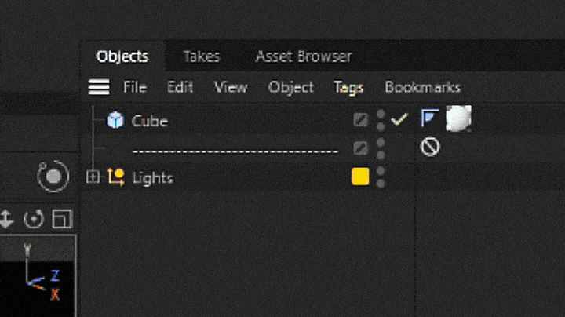
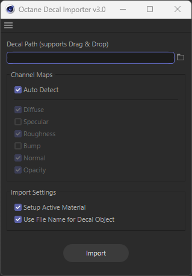
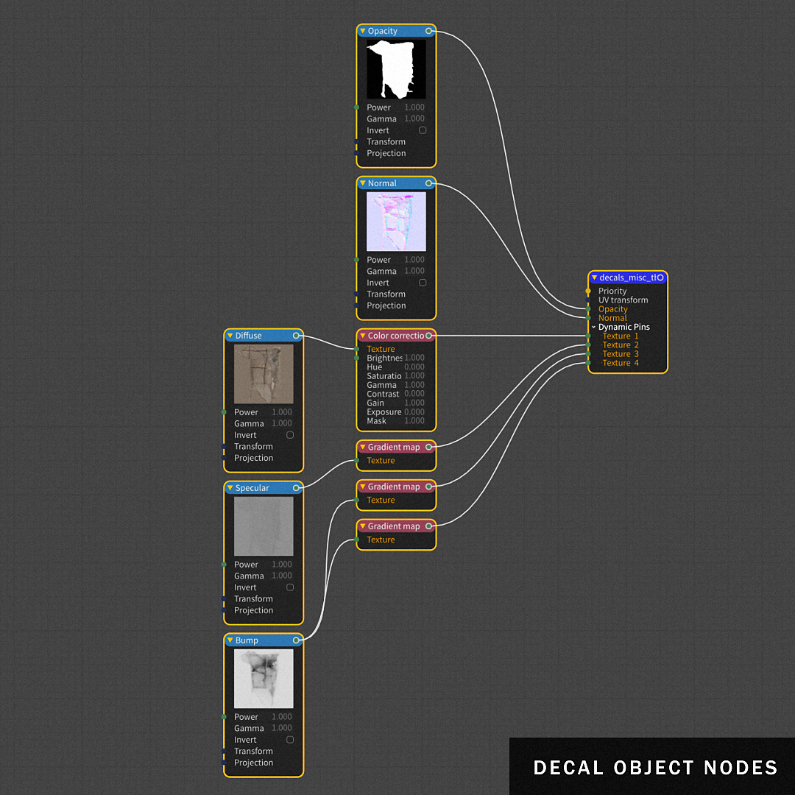
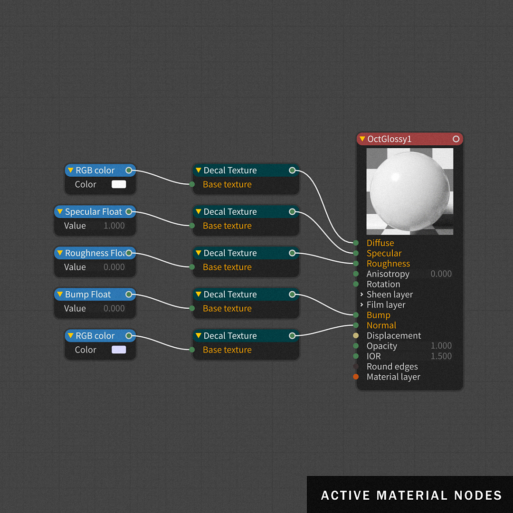

<p align="center">
  
</p>

# Octane Decal Importer

<br>

<p align="center">
  
</p>

<br>

Octane for Cinema 4D support decals as a separate object.

However it's quite tideous having to setup each and every decal object by importing image textures into the node graph, connect it to appropritate slots and maybe add any extra nodes to tweak the colors and intensity of those textures.

It's a nightmare when you don't know what you want and just want to try a bunch of different decals to see which looks best. This command plugin accepts PBR texture sets as well as standalone sticker images, creates an Octane decal object, and can set up the active PBR material with decal texture nodes.

All the functionality is listed below in detail. Don't forget to checkout [Notes](#notes) section too!

<br>

<h3 align="center">
  ✦ Available on → <a href="https://payhip.com/b/9WRHw"><u>PAYHIP</u></a> | <a href="https://oblvyn.gumroad.com/l/octane_decal_importer"><u>GUMROAD</u></a> ✦
</h3>

<br>

## Features
<p align="center">
  
  &nbsp;&nbsp;
  
  &nbsp;&nbsp;
  
</p>

- Supports a **PBR texture-set folder**, one or more dropped PBR map files, or a **single standalone image**.

- **Drag and drop image(s) or a folder** into the Decal Path input, or use browse button.

- **Detects alpha** in a standalone image and automatically wires a second non-colour image node to the decal opacity input.

- **Automatically sets up the active octane material (outermost material tag) with the decal object nodes.**

- Supports selective texture maps imports or uses the available texture maps automatically by default.

- Can use the source file/folder name as decal object name. *(file name for single image or parent folder name for PBR)*

- Remembers the previous dialog settings between launches.

- Adds Color Correction Node and Gradient Nodes to Diffuse and Info maps respectively, fallbacks to float texture for unavailable texture maps.

<br>

## Notes

- **It is highly recommended to use latest version of Octane Render as earlier build have mutliple bugs in decal object and I have removed the corrective measures for it in v3 or above releases.** *(refer to [this section](#other-changes) for more details)*

- I tried my best to implement auto detection of texture maps with ever absurd naming conventions but its never enough!<br>
So please try to keep/rename the image files with some simple yet clear channel name when import PBR decal. *(preferably separated by an underscore '_')*

- For placing the decal object I highly recommend using C4D's `Place` tool with `Up Direction` set to `-Z`. <br>
The importer rotates the created decal so that its local **-Z** direction faces up, allowing a decal to appear immediately on Cinema 4D's default plane.

- I am using displacement map for the bump input, as that is what I found looks the best to me.

- When using decals in a material with displacement you will see some artefact, thats not due to the script. that's just due to the overlaping of decal object and the polygonal object. I'll advice to NOT use displacement when using decals atleast when applying via octane decal object.

- The texture slots in decal object are reserved to the following texture maps for the sake of consistency.
    ```
    Texture 1 -> Diffuse
    Texture 2 -> Specular
    Texture 3 -> Roughness
    Texture 4 -> Bump
    ```

<br>

<h3 align="center">
  ✦ Available on → <a href="https://payhip.com/b/9WRHw"><u>PAYHIP</u></a> | <a href="https://oblvyn.gumroad.com/l/octane_decal_importer"><u>GUMROAD</u></a> ✦
</h3>

<br>

## Patch Notes

**v3.0**

- **Major Changes**

    - Converted to an official plugin!

    - Added support for importing Non PBR single image files. *(for using simple png stickers as decals)*

    - Slightly modified UI with proper spacing and group borders.

    - Decal path input now supports drag and drop although currently limited to a single image/folder path only

- **<a id="other-changes"></a>Other Changes**

    - Discarded `Box Projection` and `Transform` nodes from decal object node graph which was earlier implemented as a corrective measure for some bug from octanes's side, newer version of octane doesn't have it anymore.

    - Discarded Aspect Ratio Matching, `Object Size` and `Orientation` options for less confusion. <br>
    Decal Object is now creted wtih default size and ratio. Make sure to use c4d's `Place` tool with `-Z` as Up Direciton to correctly place it on any surface.

    - Renamed `Use Folder Name` checkbox to `Use File Name` since plugin now also supports single non-pbr image.

    - Diffuse Image Texture Node color space defaults to sRGB. *(a new option in newer octane versions)*

    - Normal Image Texture Node color space defaults to non-color. *(visually no difference but for consistency)*

    - Plugin now loads previous settings/options from a locally stored config file.

**v2.1**

  - Updated decal object's diffuse channel fallback node to RGB Spectrum.

  - Added orientation options, along Y or Z axis (also handles inverted image bug for Y axis).

**v2.0**

  - Connects the active PBR material (outermost material tag) with the Decal object.
  
  - Added an Object Size parameter (defaults to 500) to set the size of your decal object when created. The unit of value is your default scene scale (eg. cm)

  - Selects the most recently created decal object at the end of script.

  - Extended file search logic to support even absurd naming conventions. Still recommended to name the image files with clearly distinguishable channel name (preferably separated by an underscore '_')

**v1.1**

  - Refactored file search logic to support various naming conventions. *(It is still recommended to separate the channel name in the file name with an _ or a space.)*

  - Selects the most recently created decal object at the end of script.

**v1.0**

  - Initial release.

<br>

*If you encounter any error or have feature ideas you can let me know about it. I'll try to implement them it in a future release.*

